# BAILE: a Brazilian funk tracker for the M-VAVE FM-1

[Português](README.md) · **English**

<p align="center">
  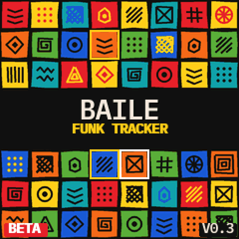
  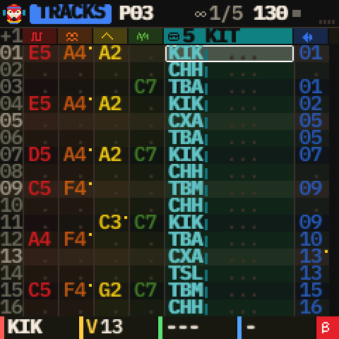
  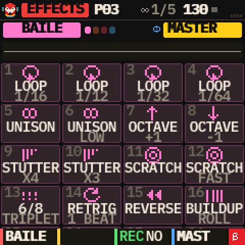
</p>

**BAILE** is a free firmware for the **M-VAVE FM-1**, made for **Brazilian funk**: tamborzão, Volt Mix, funk 150,
mandelão, brega funk and montagem. It is a *tracker*: each row is a step, each column a track, and the song runs down
the screen. It is a fork of [KAWA](https://github.com/Guizmoh/Kawa-Tracker-Fm1), by Omnipotard.

[Site and installer](https://saulofilho.github.io/baile-fm1/en/) ·
[Emulator](https://saulofilho.github.io/baile-fm1/emulator/#en) ·
[Manual](https://saulofilho.github.io/baile-fm1/manual/en.html) ·
[Sample importer](https://saulofilho.github.io/baile-fm1/samples.en.html) ·
[Releases](https://github.com/saulofilho/baile-fm1/releases)

**Contents:** [screens](#see-it) · [status](#status) · [features](#features) · [first tamborzão](#a-first-tamborzão) ·
[buttons](#buttons) · [install](#install) · [samples](#your-samples) · [compatibility](#compatibility) ·
[rescue](#rescue) · [back to official](#back-to-the-official-firmware) · [build](#build-and-test) ·
[credits](#credits-and-licence)

## See it

Screens of the 0.3 firmware (not released yet), taken in the simulator with the BAILE demo.

### Build the beat

<table>
  <tr>
    <td align="center"><br>Boot: the mosaic</td>
    <td align="center"><br>TRACKS: the song runs down the screen</td>
    <td align="center">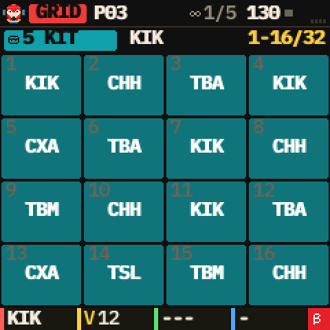<br>GRID: the 16 steps</td>
  </tr>
</table>

### Sound

<table>
  <tr>
    <td align="center">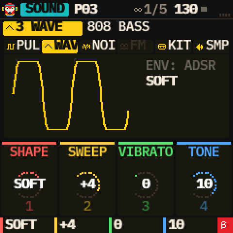<br>SOUND: the 808 BASS</td>
    <td align="center">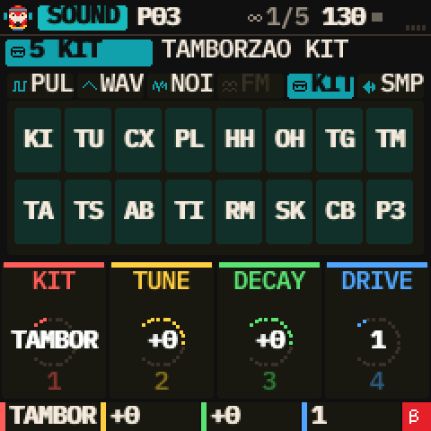<br>SOUND: the TAMBOR kit</td>
    <td align="center">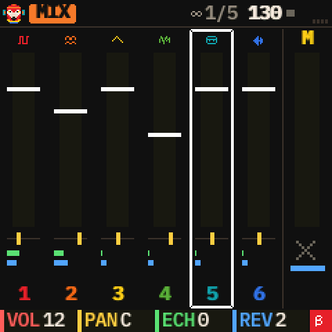<br>MIX: the six tracks</td>
  </tr>
</table>

### Funk

<table>
  <tr>
    <td align="center">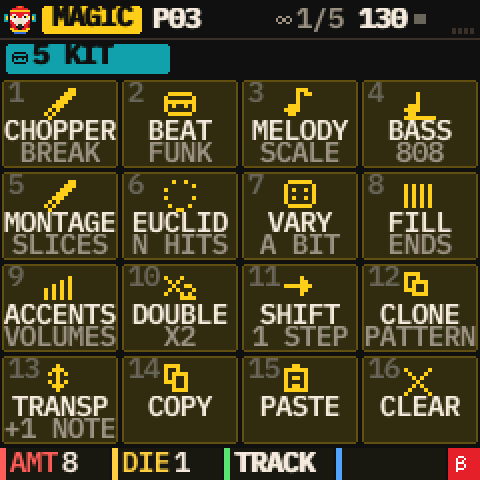<br>MAGIC: writes the funk</td>
    <td align="center">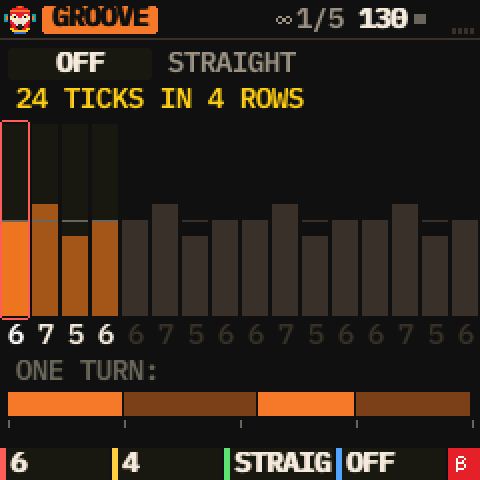<br>GROOVE: the late tamborzão step</td>
    <td align="center">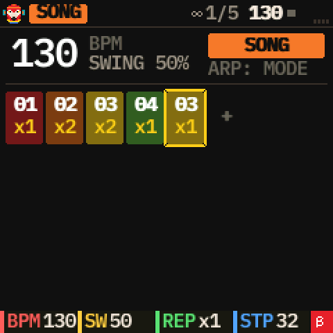<br>SONG: patterns in a row</td>
  </tr>
</table>

### Live

<table>
  <tr>
    <td align="center"><br>BAILE bank</td>
    <td align="center">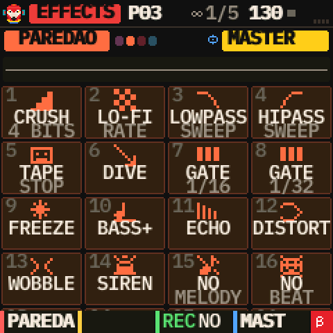<br>PAREDAO bank</td>
    <td align="center">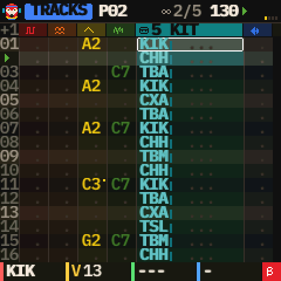<br>Playing</td>
  </tr>
</table>

### Destroy

<table>
  <tr>
    <td align="center">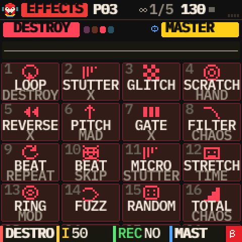<br>DESTROY bank</td>
    <td align="center">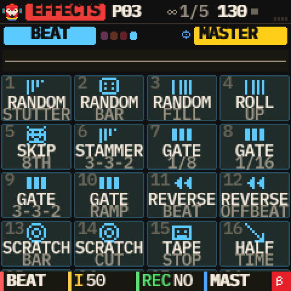<br>BEAT bank</td>
    <td align="center">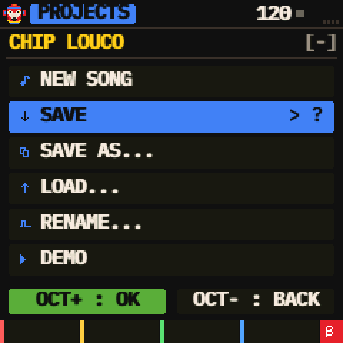<br>PROJECTS and the demos</td>
  </tr>
</table>

### Themes

<table>
  <tr>
    <td align="center">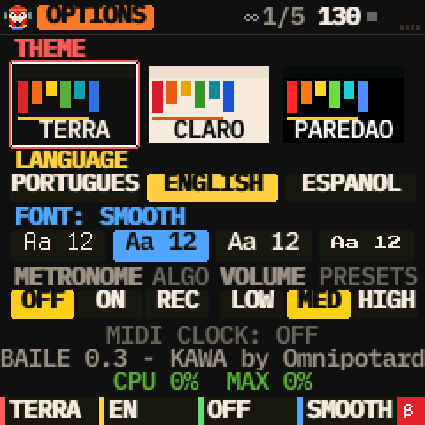<br>TERRA</td>
    <td align="center">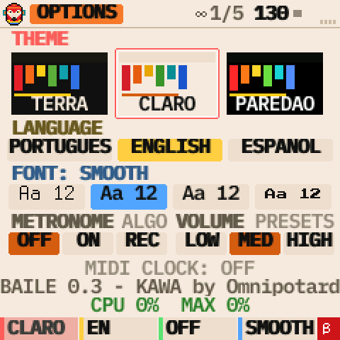<br>CLARO</td>
    <td align="center">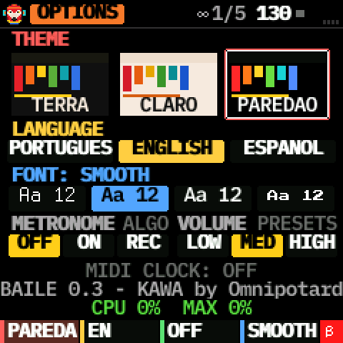<br>PAREDAO</td>
  </tr>
</table>

## Status

| | |
| --- | --- |
| Released version | **0.2 beta** |
| Identity | `FM-1_808130` from 0.3 on. 0.1 and 0.2 answer `FM-1_971` |
| On a real FM-1 | 0.1 was installed from another firmware (`FM-1_966`), then 0.2 over it. What was and was not confirmed: [results](docs/TEST-RESULTS.md) (in Portuguese) |
| In this repository | Heading for 0.3: tested on a computer only |
| Defects in 0.2 | With the language set to Portuguese, the DESTROY and BEAT banks and the language's own name show in French, and a few labels are wrong. Fixed in the source, due in 0.3 |

An unofficial firmware, not made or endorsed by M-VAVE. Install it at your own risk.

## Features

The names below are the English screen's. The FM-1 starts in Portuguese: change it in OPTIONS (GLO three times,
KNOB 2).

### The tracker

- **Six tracks**, each with an engine: pulse, 4-bit wave, noise, 6-operator FM (one track), drum kit, or a sample in
  16 slices.
- **32 patterns** of 16, 32 or 64 steps, chained into a song.
- In each cell a note, a volume and up to **two effects**: arpeggio, glide, vibrato, roll, chance, delay, cut,
  reverse, pitch, hop, end.
- A **table** per track (a small sequence inside the note), a **groove** per step, an 11-type filter and an effect
  sequencer.
- Drive, echo and reverb per track, a metronome, MIDI clock and USB audio.
- Undo and redo, a song that saves itself and **three project slots**.
- The screen in **Portuguese**, English or Spanish.

### The 8 kits

The 16 white keys are 16 drums. In every kit key 1 is the kick, 2 the second kick, 3 the snare, 5 and 6 the closed
and open hat.

| Kit | The sound |
| --- | --- |
| **VOLT** | Miami bass's 808: long kick, clap, cowbell, clave, congas |
| **TAMBOR** | The tamborzão: dry kick, TUM, dry snare, claps, atabaque drums |
| **150** | Short and hard: dry kick, distorted punch, cracking snare, metal |
| **MANDELA** | Mandelão: blown-out kick, sub, anvils, eerie noise swells, laser |
| **BREGA** | Brega funk: two kicks, doubled claps, timbales |
| **MELODY** | The clean drum machine of 2000s funk melody |
| **TUIN** | Baile effects: sirens, whistle, falling tuin, laser, shot, explosion |
| **PERCUS** | Atabaques, surdo, tamborim, agogô, cuíca, pandeiro, reco-reco, ganzá |

### Breaks and sounds

- **Six breaks** in 16 slices: TAMBORZAO, VOLT, FUNK 150, MANDELAO, BREGA FUNK, MONTAGEM.
- **Funk sounds:** 808 BASS (with punch and glide), BENT 808, SUB, MELODY LEAD, MELODY PIANO, STAB and SIREN, next to
  KAWA's factory sounds.
- The kits and breaks are **synthesised**, with no recordings from records. Where each part comes from is in
  [LICENSING.md](LICENSING.md).

### MAGIC (SCL twice)

| Tool | What it does |
| --- | --- |
| **BEAT FUNK** | Writes the funk of the track's kit. Strength adds layers |
| **BASS 808** | The bassline in 3-3-2, mostly on the root, with glides |
| **MONTAGE** | Pieces of the break or kit that repeat, some reversed |
| **FILL** | Rolls and the snare fill at the end of the bar |
| And more | Chopper, melody, Euclid, variations, accents, double, shift, clone, transpose, copy and paste |

### Grooves

| Groove | Ticks a step | The feel |
| --- | --- | --- |
| STRAIGHT | 6 6 | None |
| TAMBOR | 6 7 5 6 | The late second 16th |
| BREGA | 7 5 | Brega funk's swing |
| 150 | 6 5 7 6 | Pushes the second |
| MANDELA | 7 5 6 6 | Drags |
| TRIPLET | 4 4 4 | Triplets |

### 64 live effects

Hold **FX** and play the white keys. There are four banks (OCT− and OCT+): **BAILE** and **PAREDAO**, and K-GLITCH's
**DESTROY** and **BEAT**. Stutter, scratch, buildup, gate, reverse, tape stop, bass+, echo, siren and many more, on
the master or on one track. With REC, the effect is recorded into the pattern.

### Four demos

Each load of DEMO brings the next one:

| Demo | Style | BPM |
| --- | --- | --- |
| BAILE | Tamborzão | 130 |
| VOLT | Miami bass | 128 |
| MANDELAO | Mandelão | 130 |
| BREGA FUNK | Brega funk | 150 |

To hear one: **SAVE**, go down to DEMO with **SELECT**, **OCT+** (once more if it asks about the unsaved song),
**PLAY**.

### The look

A mosaic of hand-painted tiles on black, in the colours of a macaw's feathers, one colour per track. The mascot is a
macaw wearing headphones. Three themes (TERRA, CLARO, PAREDAO) and four screen fonts.
[Mood board](https://saulofilho.github.io/baile-fm1/docs/moodboard/).

## A first tamborzão

1. **SAVE**, new song. Track 5 is already the TAMBOR kit and track 3 the 808 BASS.
2. On track 5 (ALGORITHM), press **SCL** twice and tap **BEAT FUNK** (key 2).
3. On track 3, tap **BASS 808** (key 4).
4. **GLO** twice, pick the TAMBOR groove with KNOB 3 and turn it on with KNOB 4.
5. **PLAY**. Hold **FX** and play the white keys.

## Buttons

| Button | What it does |
| --- | --- |
| **HOME** | The tracks. Held: the page's help. **HOME + PLAY**: panic, everything stops |
| **SEQ** | The step grid. OCT− and OCT+: 16, 32 or 64 steps |
| **EDIT** | The sound: SOUND, SOUND 2, operators or sample edit, EFFECT, TABLE |
| **LFO** | LFO, then MODULATION |
| **ENV** | ENVELOPE, then MIX |
| **FX** | SENDS, LIVE, FILTER, FX SEQ. Held: LIVE |
| **SCL** | SCALE, then MAGIC |
| **GLO** | SONG, GROOVE, OPTIONS |
| **SAVE** | PROJECTS. Held: the tools, and OCT− and OCT+ undo and redo |
| **PLAY**, **REC** | Play and stop; record |
| **ARP** | Clears the cell. Held, it is the shift key |
| **SELECT** | The row or the page |
| **ALGORITHM** | The track |
| **PRESETS** | The factory sound or the pattern. With ARP held, the engine |
| **KNOB 1 to 4** | What the bottom line of the screen says: red, yellow, green, blue |

All of it in detail, with screens, in the [manual](https://saulofilho.github.io/baile-fm1/manual/en.html).

## Install

You need an FM-1, a USB **data** cable and stable power. Close other MIDI programs and back up what matters: BAILE
does not read other firmwares' projects.

**From the browser (Chrome, Edge, Opera):** open the [site](https://saulofilho.github.io/baile-fm1/en/), plug the
FM-1 in over USB and click the install button.

**With a launcher:** download the repository (*Code*, *Download ZIP*), unzip it and run the one for your system, with
[Python 3](https://www.python.org/downloads/) installed:

| System | File |
| --- | --- |
| Windows | `INSTALL-Windows.bat` |
| macOS | `INSTALL-Mac.command` (the first time: right click, Open) |
| Linux | `./INSTALL-Linux.sh` |

**From a terminal:**

```bash
python3 -m venv .venv
.venv/bin/pip install mido python-rtmidi
.venv/bin/python install/fm1_install.py install/baile-0.2.fwsc
```

The whole package is checked before anything is erased. The write can be slow (25 minutes in one of our tests). Do
not switch off. If the cable drops, plug it back in and run it again: the install resumes. To see what is installed,
without writing anything:

```bash
.venv/bin/python install/fm1_install.py --info
```

The packages' SHA-256 sums are in [install/SHA256SUMS](install/SHA256SUMS).

## Your samples

There are four slots, MY 1 to MY 4: mono, 8-bit mu-law, up to 1.66 s at 22,050 Hz or 3.3 s at 11,025 Hz. Use the
[importer in the browser](https://saulofilho.github.io/baile-fm1/samples.en.html) or, with BAILE stopped:

```bash
.venv/bin/python install/baile_samples.py put 1 sound.wav --name SOUND
```

On the FM-1: SOUND page, SAMPLE engine, source MY 1 to MY 4. Use sounds that are yours or that you may use.

## Compatibility

- **BAILE does not read projects or samples of KAWA, of the official firmware or of any other firmware**, and they do
  not read BAILE's.
- It accepts both known FM-1 flash chips: `0x856014` and `0xB36014`. On an unknown chip the updater writes nothing.
- In the emulator, projects are kept by the browser and exported and imported as `.baile`.

## Rescue

Hold **OCT−** while switching on, or wait: after two failed starts in a row the FM-1 opens the USB rescue by itself
(`BAILE USB RESCUE`). From there, run the installer again.

Common problems:

| Problem | What to do |
| --- | --- |
| The installer does not find the FM-1 | A data cable, other MIDI programs closed, a browser with Web MIDI |
| Silence | BAILE starts empty: record notes or load a DEMO |
| PRESETS does not change the sound | You edited it: the next one shows in gold, OCT+ loads it |
| A click in the USB recording | It is the metronome: turn it off in OPTIONS |
| A mistake | Hold SAVE and press OCT− |

## Back to the official firmware

1. BAILE's projects and samples are lost.
2. Use stable power and a data cable. If BAILE behaves oddly, open the USB rescue first.
3. Install the official **V15** (`FM-1_015`) with M-VAVE's **M-UPGRADE**.
4. **Do not unplug anything during the transfer**: the official installer rewrites the bootloader too. This is the
   riskiest step ([details](source/BUILDING.md#safety-rescue-and-back-to-the-official-firmware)).

## Build and test

The simulator runs on macOS and Linux, with the system C compiler:

```bash
python3 -m venv .venv
.venv/bin/pip install pillow numpy mido python-rtmidi
cd source
export PATH="$PWD/../.venv/bin:$PATH"
tests/run_host.sh
```

| What | Command, inside `source/` |
| --- | --- |
| Features, format, kits, interface | `tests/run_features_test.sh`, `tests/run_format_test.sh`, `tests/run_kits_test.sh`, `tests/run_ui_test.sh` |
| Stress | `sh tests/run_stress_test.sh` |
| Breaks | `python3 tests/breaks_check.py` |
| Emulator | `web/make_emulator.sh` (clang and lld), then `node tests/emulator_test.js` |
| FM-1 package | `PYTHON=../.venv/bin/python ./build.sh` (Docker, JieLi toolchain, AC79 SDK) |
| Updater, installer, samples | `tests/run_loader_tests.sh`, `node tests/webinstall_test.js`, `node --test tests/websamples_test.js` |
| Translations | `python3 tools/i18n_slots.py check tools/i18n_pt.json` |
| Site | `python3 tools/gen_site.py` |

| Folder | What is in it |
| --- | --- |
| `source/firmware/` | The firmware |
| `source/tools/` | Generators for art, fonts, breaks, translations, site and package |
| `source/tests/` | Simulator and tests |
| `source/web/` | Sources of the emulator and the site |
| `install/` | Packages, installers and the sample tool |
| `manual/`, `docs/` | Manual, test results, mood board, references |

Full guide: [source/BUILDING.md](source/BUILDING.md). Plan (in Portuguese): [PLAN.md](PLAN.md). Bugs and ideas:
[issues](https://github.com/saulofilho/baile-fm1/issues), with the version, what you did and what happened.

## Credits and licence

BAILE, by saulofilho, on the work of:

- **[KAWA](https://github.com/Guizmoh/Kawa-Tracker-Fm1)** and **[K-GLITCH](https://github.com/Guizmoh/K-Glitch)**, by
  Omnipotard: the engine, the tracker and the DESTROY and BEAT banks.
- **[Felucca](https://github.com/hugelton/Felucca)**, by Leo Kuroshita (Hügelton Instruments): the platform, the
  updater and eight of the FM patches.
- **[SLOOP](https://github.com/isod89/sloop-fm1)**, by isod89, and **[Dinghy](https://github.com/zvenson/dinghy)**,
  by zvenson: the platform.
- **msfa**, by Google and Pascal Gauthier, via Dexed (Apache-2.0): the FM synthesis.
- The fonts Terminus, IBM Plex Mono, Atkinson Hyperlegible Mono and Press Start 2P (OFL).

**GPL-3.0-only:** you may use, study, change and share it, and whoever receives a firmware built from it receives the
source too. Text in [LICENSE](LICENSE), details in [LICENSING.md](LICENSING.md). "M-VAVE" and "FM-1" belong to their
owners.
